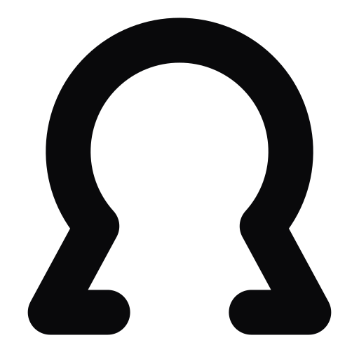

# Build and launch websites and apps directly in Claude

Build websites, forms, client portals and web apps by describing what you need in Claude. Keep improving your project in the same conversation, preview it, and publish it to a shareable URL when you are ready.

ohmyho.st provides hosting and managed PostgreSQL for applications that need a database. Create a landing page, collect form submissions or build a customer portal, then return to the same chat to make changes.

So simple this is just amazing and lovable.

## Connect and start

1. Connect ohmyho.st to Claude using your own account.
2. Tell Claude what you want to build and try the app it creates.
3. Ask Claude to put it online when you're happy with it.

You approve access and choose when your app goes live. An ohmyho.st account and hosting credits are required. The connection uses managed OAuth and the declared first-party server at `https://app.ohmyho.st/mcp`; you don't paste tokens into chat.

The plugin has four self-contained workflows: connecting to the correct account/project, preparing supported application source, saving/deploying a concrete version and publishing its inspected preview, and diagnosing failures. They use only the declared remote connector's tools. Vite/React, Next.js, TanStack Start and plain Worker apps follow the hosting contract. For new ordinary chat-built apps, the Vite/React template supplies the initial source. A persisted GitHub binding can deploy an already pushed selected commit; this plugin does not edit or push the GitHub repository.

## Examples

- "Build a booking app for my business. Let me try it, then put it online."
- "Add a customer dashboard to the app we built. Show me how it looks."
- "I like this version. Put it online and give me a link I can share."

## What runs and what data is handled

The package contains four static Markdown Skills, one remote MCP configuration, brand and license files, and a source receipt. It has no hooks, commands, local MCP executable, installer, interpreter, executable helper, extension, local file workflow, environment-variable input or persistent password configuration. It does not execute code on the user's machine, collect local credentials, inspect another application's credential store, or fetch behavioral instructions from outside the package.

Requests to the declared first-party ohmyho.st service can read the selected project's files, saved versions, status, configuration metadata and deployment diagnostics; requested writes save application source, create builds/previews, promote the inspected artifact, or restore/roll back the explicitly selected version. The declared service runs the application's build and hosted code in its own infrastructure. That server-side hosting is the product's function; no local process is launched by this plugin. Cloudflare provides hosting, builds, Git and file infrastructure, the open-source [PGCF](https://github.com/amerged-org/cloudflare-postgres) platform runs managed PostgreSQL on Contabo servers behind the hosting service, and WorkOS handles account identity. The agent does not configure those providers or access their credentials.

Application secrets use protected portal input. The user enters the value in that portal; the chat receives only a link, request status and secret metadata. Private approval and preview links are kept out of application source and shared notes. Only data necessary for the selected project action is sent; these workflows do not collect unrelated conversation history, uploaded files or other applications' data.

Database administration/export, Supabase migration, custom-domain/mail administration, usage/budget changes, payments, subscriptions and auto-recharge are outside this plugin's scope. The wider ohmyho.st CLI and independently installed tools can have other capabilities; this plugin does not disable them and does not use them. When such a prerequisite is needed, the user completes it manually in their signed-in workspace or a separately chosen environment.

## Documentation and support

Read the [documentation](https://docs.ohmyho.st/), [support guide](https://docs.ohmyho.st/support), [privacy policy](https://ohmyho.st/privacy), and [terms](https://ohmyho.st/terms). Contact ohmyho.st through [the contact page](https://ohmyho.st/contact).

This Apache-2.0 package is a Claude-specific remote-only curation derived from the released ohmyho.st customer workflows at source commit `f9de246dbdef023d1aa17e52353b486daa46ff4f`. None of its four Skills is claimed to be a byte-identical canonical Skill. The source receipt identifies the derivation. The private hosting platform and the full local CLI capabilities are not included. Local validation and independent review are separate from native testing and Anthropic's directory acceptance.
